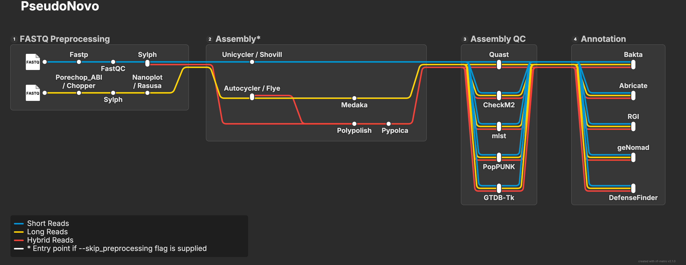

# PseudoNovo

**PseudoNovo** is a specialised ***Pseudo***monas de-***Novo*** assembly pipeline written in Nextflow. It can handle short, long or hybrid read datasets and performs read QC, assembly, assembly QC and annotation.



## Setup

1. First ensure you have [Nextflow](https://docs.seqera.io/nextflow/install#installation) installed
2. Next ensure you have either [Docker](https://docs.docker.com/engine/install/) or [Singularity](https://docs.sylabs.io/guides/3.0/user-guide/) installed
3. Clone the repo with ``git clone https://github.com/tmorr-12/PseudoNovo``
4. Setup the required databases (see below)

## Databases

**PseudoNovo** makes use of several databases. You can tell the pipeline which database to use either via the command line or by editing the `qc.config` file. If you do not provide a path to a specific database, the pipeline will automatically download it for you. Any downloaded databases are saved to the `results/databases` directory. Downloads take several hours; you are encouraged the move them somewhere safe so they can be reused.

> **NOTE:** Most HPC's have a central database store. You are encouraged to use the paths issued by your local supplier.

| Tool | Database | Info | Link |
| --- | --- | --- | --- |
| Sylph | gtdb-r232-c200-dbv2.syl2db | https://sylph-docs.github.io/pre%E2%80%90built-databases/ | http://faust.compbio.cs.cmu.edu/sylph-stuff/gtdb-r232-c200-dbv2.syl2db |
| CheckM2 | uniref100.KO.1.dmnd | https://github.com/chklovski/CheckM2#database | https://zenodo.org/records/14897628/files/checkm2_database.tar.gz?download=1 |
| PopPUNK | pa_v1_refs (v1)| https://bacpop.org/poppunk-databases/ | https://ftp.ebi.ac.uk/pub/databases/pp_dbs/Pseudomonas_aeruginosa_v1_refs.tar.bz2 |
| GTDB-Tk | latest (r232) | https://gtdb.ecogenomic.org/ | https://data.gtdb.ecogenomic.org/releases/latest/auxillary_files/gtdbtk_package/full_package/gtdbtk_data.tar.gz |
| Bakta | db (6.0) | https://zenodo.org/records/14916843 | https://zenodo.org/records/14916843/files/db.tar.xz?download=1 |
| RGI | latest (card 4.0.2) | https://card.mcmaster.ca/ | https://card.mcmaster.ca/download/0/broadstreet-v4.0.2.tar.bz2 |
| geNomad | genomad_db (v1.9) | https://zenodo.org/records/14886553 | https://zenodo.org/records/14886553/files/genomad_db_v1.9.tar.gz?download=1 | 
| CheckV | checkv-db-v1.5 | https://bitbucket.org/berkeleylab/CheckV/src/master/#markdown-header-checkv-database | https://portal.nersc.gov/CheckV/ |


## Usage
Parameters can be passed via the command line or preferably by editing the 'qc.config' file located in this repo.

```
nextflow run main.nf --input <path/to/manifest.csv> [options]
```

## Generating a manifest
To generate a manifest see [Manifest-Generator](https://github.com/tmorr-12/Manifest-Generator)

## Workflow

There are 3 main workflows: **Preprocessing**, **Assembly** and **Annotation**:

**Preprocessing:**
1. Short reads are optionally trimmed with [fastp](https://github.com/opengene/fastp) and QC checked with [FastQC](https://github.com/s-andrews/fastqc). Long reads are QC checked with [Nanoplot](https://github.com/wdecoster/nanoplot), adaptors optionally trimmed with [Porechop_ABI](https://github.com/bonsai-team/Porechop_ABI), and reads filtered using [Chopper](https://github.com/wdecoster/chopper).
2. Contamination is assessed using [Sylph](https://github.com/bluenote-1577/sylph). 
3. Long reads can be optionally downsampled with [Rasusa](https://github.com/mbhall88/rasusa)
4. A fastq preprocessing summary report is compiled and saved to the results directory
>**INFO:** You can skip preprocessing with the ``--skip_preprocessing`` flag

**Assembly:**

1. Short reads are assembled using [Unicycler](https://github.com/rrwick/unicycler) (or [Shovill](https://github.com/tseemann/shovill)), long reads are assembled using [Autocycler](https://github.com/rrwick/Autocycler) (or [Flye](https://github.com/mikolmogorov/Flye)) and polished using [Medaka](https://github.com/nanoporetech/medaka). Hybrid reads are also assembled using [Autocycler](https://github.com/rrwick/Autocycler), before polishing with [Polypolish](https://github.com/rrwick/Polypolish) and [Pypolca](https://github.com/gbouras13/pypolca)
2. Assembly QC is performed using [Quast](https://github.com/ablab/quast), [CheckM2](https://github.com/chklovski/CheckM2) and [GTDB-Tk](https://github.com/ecogenomics/gtdbtk). Assemblies are sequenced typed with [MLST](https://github.com/tseemann/mlst) and assigned to clusters with [PopPUNK](https://github.com/bacpop/PopPUNK).
3. An assembly summary report is compiled and saved to the results directory.


**Annotation:**

1. Reads are annotated using [Bakta](https://github.com/oschwengers/bakta).
2. Plasmids are screened with [Abricate](https://github.com/tseemann/abricate) and the PlasmidFinder database.
3. AMR resistance genes are screened using [RGI](https://github.com/arpcard/rgi) and the CARD database.
4. Prophages are identified with [geNomad](https://github.com/apcamargo/genomad) and the quality of identified viral elements are assessed with [CheckV](https://bitbucket.org/berkeleylab/CheckV/src/master/).
5. Anti-phage defense systems are screened using [DefenseFinder](https://github.com/mdmparis/defense-finder).

## Quality Control

Two QC reports are generated during the pipeline summarising FASTQ preprocessing and assembly quality. The FASTQ preprocessing report is as such:

| ID | QC Status | QC Failed Fields |
|---|---|---
| SampleA | PASS |  |
| SampleB | FAIL | sylph, fastp |

In the above example, SampleA passed all FASTQ QC filters, whereas SampleB failed the sylph and fastp QC checks. A summary of all QC options can be found below.

The assembly qc report is as such:

| ID | classification | N50 | Total length | # contigs | # contigs (>= 1000 bp) | Completeness | Contamination | GC_Content | Total_Coding_Sequences | Max_Contig_Length | Cluster | ST | ALLELES | QC Status | QC Failed Fields |
|---|---|---|---|---|---|---|---|---|---|---|---|---|---|---|---|
| Sample ID | GTDBTk classification | Quast N50 | total assembly length | no. contigs | no. contigs about 1000bp | CheckM2 completeness | CheckM2 contamination | genome GC content | total CDS | size of largest contig | PopPUNK cluster | sequence type | MLST alleles | PASS / FAIL | comma separated list of failed fields (if QC Status == "FAIL") |


### Short Read QC

| Option | Description | Default |
|---|---|---|
| fastqc_pass_criteria  | FASTQC pass criteria | "assets/fastqc_pass_criteria.json" |
| lower_assembly_length | Lower bound for assembly length when assessing read depth with fastp | 5500000 |
| min_contig_length     | Minimum contig length for assembly | 500 |
| unicycler_mode        | Unicycler mode for short reads | "conservative" |

### Long Read QC 

| Option | Description | Default |
|---|---|---|
| long_read_platform  | "ont" or "pacbio" | "ont" |
| trim_adaptors       | Trim adaptors from long reads | false |
| minimum_phred_score | Minimum phred score for long reads | 15 |
| min_read_length     | Minimum read length for long reads | 1000 |
| downsample_reads    | Downsample long reads | false |
| target_coverage     | Target read coverage if downsampling reads | 30 |
| autocycler_subsets  | Number of subsets to use for autocycler | 4 |

### Assembly QC

| Option | Description | Default |
|---|---|---|
| min_depth| Minimum read coverage | 30 |
| target_genome_size | Assembly QC fails if genome size ±20% of target size  | 6250000 |
| target_gc_content | Assembly QC fails if genome GC content ±2% of target amount | 0.66 |
| completeness | CheckM2 min completion threshold | 99 |
| contamination | CheckM2 max contamination threshold | 5 |

## Options

You can access all options and parameters by running ``nextflow run <path/to/main.nf> --help``.

```
Usage:
    nextflow run main.nf --input manifest.csv [options]

Parameters can be passed via the command line or preferably by editing the 'qc.config' file.

Main:
    --input                             (Required) Path to input manifest, see README.md for details
    --mode                              Options: short, long, hybrid (default: short)
    --skip_preprocessing                Skip preprocessing step (default: false)
    --help                              Show this help message and exit

Assembly:
    --short_assembler                   Options: unicycler, shovill (default: unicycler)
    --long_assembler                    Options: autocycler, flye (default: autocycler)

Databases:
    --sylph_db                          Path to sylph database (e.g. /path/to/.sylphdb)
    --checkm2_db                        Path to checkm2 database (e.g. /path/to/.dmnd)
    --bakta_db                          Path to bakta database (e.g. /path/to/database)
    --card_db                           Path to card database (e.g. /path/to/card)
    --poppunk_db                        Path to poppunk database (e.g. /path/to/pa_v1_refs)
    --gtdb                              Path to genome taxonomy database (e.g. /path/to/release232)
    --genomad_db                        Path to genomad database (e.g. /path/to/genomad_db)
    --checkv_db                         Path to checkv database (e.g. /path/to/checkv-db-v1.5)
    --defensefinder_models              Path to defense finder models (e.g. /path/to/.macsyfinder/models)

QC Options:
    --min_depth                         Minimum read coverage (default: 30)
    --target_genome_size                Assembly QC fails if genome size ±20% of target size (default: 6250000)
    --target_gc_content                 Assembly QC fails if genome GC content ±10% of target amount (default: 0.66)
    --completeness                      Threshold CheckM2 completeness score to pass QC (default: 99)
    --contamination                     Threshold CheckM2 contamination score to pass QC (default: 5)

Short Read Options:
    --fastqc_pass_criteria              Path to FASTQC pass criteria (default: "assets/fastqc_pass_criteria.json")
    --lower_assembly_length             Lower bound for assembly length when assessing read depth with fastp (default: 5500000)
    --min_contig_length                 Minimum contig length for short reads (default: 500)
    --unicycler_mode                    Unicycler mode for short reads (default: "normal")
    --reference                         Path to reference genome, used to map reads for additional QC
    --min_mapping_rate                  Threshold proportion of reads needing to map to reference during QC (default: 0.8)
    --max_error_rate                    Maximum error rate for short reads (default: 0.02)

Long Read Options:
    --long_read_platform                Platform for long reads (options: ont, pacbio) (default: ont)
    --trim_adaptors                     Trim adaptors from long reads (default: false)
    --minimum_phred_score               Minimum phred score for long reads (default: 15)
    --min_read_length                   Minimum read length for long reads (default: 1000)
    --downsample_reads                  Downsample long reads (default: false)
    --target_coverage                   Target read coverage if downsampling reads (default: 30)
    --autocycler_subsets                Number of subsets to use for autocycler (default: 4)
```
